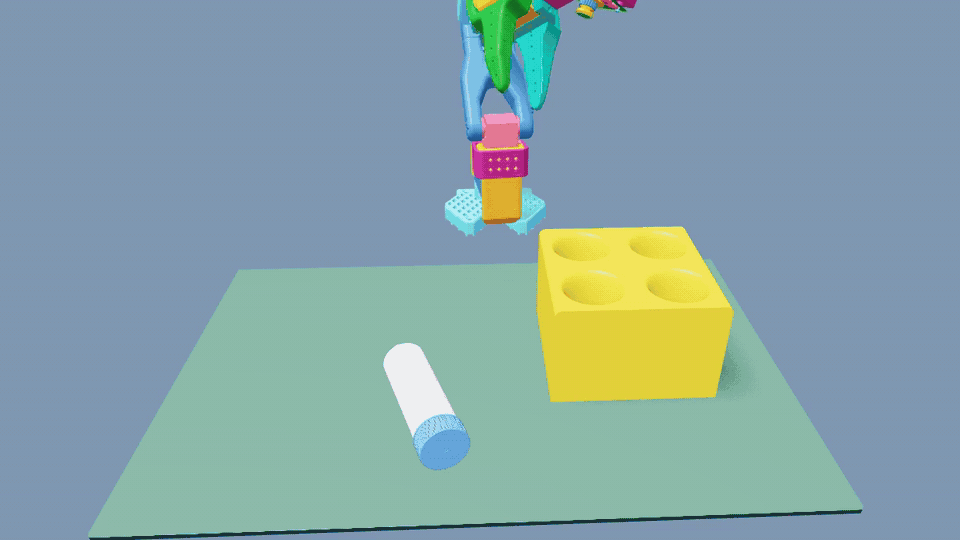

# SO-101 vial placement

<p align="center"></p>

An Isaac Lab tutorial that trains an SO-101 arm to pick up a vial lying on the desk and place it upright in
**any of the four holes** of a rack. A state policy learns the task with PPO. A wrist-camera policy is then
distilled from it, and that camera policy is the one that runs on the real robot.
Training uses **Newton MJWarp physics** and the **Newton renderer** for the camera.

Follow the [Getting Started With Isaac Lab](https://docs.nvidia.com/learning/physical-ai/getting-started-with-isaac-lab/latest/index.html)
course for guided lessons.

## Setup

Linux x86-64 or Windows 11, Python 3.12, Git LFS, an NVIDIA GPU with a CUDA 13-compatible driver, and `uv`.
Every command below is a single line, so it runs unchanged in bash, PowerShell and Command Prompt.

```bash
git lfs pull
uv sync --locked
uv run pytest -q
```

Check that the task builds and steps before training:

```bash
uv run isaaclab zero_agent --task IsaacTutorial-Place-Vial-SO101 --num_envs 8 --max_steps 100 --visualizer none presets=newton_mjwarp
```

## Manual control

Launch one SO-101 environment and send normalized joint actions from the same terminal:

```bash
uv run python scripts/manual_control.py --visualizer newton
```

At the `so101>` prompt, use `help` to list every command. A short session looks like:

```text
state
pulse shoulder_pan 0.5 30
close 20
open 20
stop
reset
quit
```

`action` accepts six values in `shoulder_pan shoulder_lift elbow_flex wrist_flex wrist_roll gripper`
order and holds them until `stop` or another command. Values are clamped to `[-1, 1]`. `pulse` applies one
joint command for a bounded number of 30 Hz control ticks, which is safer for initial experiments. Manual mode
uses one environment, starts from a canonical home pose, and disables rewards and automatic terminations so it
only resets when requested. Run a bounded headless GPU check with:

```bash
uv run python scripts/manual_control.py --smoke-test --visualizer none
```

## Codex MCP control

The local STDIO MCP server exposes the manual controller to Codex as structured tools. Register it once using
the Python executable from this checkout:

```powershell
$python = (Resolve-Path .venv/Scripts/python.exe).Path
codex mcp add so101-sim -- $python -m isaaclab_tutorial.mcp_server
codex mcp list
```

Restart the Codex desktop app, CLI session, or IDE extension after adding the server. Then ask Codex to start
the SO-101 simulator before asking it to move or inspect the robot. The server provides:

- `start_simulator` (`newton` viewer or headless `none`)
- `get_robot_state`
- `move_joint_positions` (six absolute joint angles in radians, with bounded endpoint correction)
- `pulse_joint`
- `apply_joint_actions`
- `open_gripper` and `close_gripper`
- `reset_simulator`
- `stop_simulator`

Read [the calibrated SO-101 control guide](docs/SO101_CONTROL_GUIDE.md) before manipulation. It covers
joint limits and degrees of freedom, coordinate frames, measured joint responses, reach limitations,
and how to verify a pickup. The MCP worker holds fixed servo targets while idle; relative pulses remain
pose-dependent. Restart the MCP connection after updating the server to discover new tools.

The MCP front process starts quickly and launches Isaac lazily in an isolated worker process. This keeps Isaac
logs away from the MCP STDIO protocol and ensures all simulation calls execute serially on the worker's main
thread. Commands affect only the simulation, never a physical arm. Verify tool discovery without launching
Isaac, or run the full headless round trip, with:

```powershell
uv run python scripts/mcp_smoke_test.py
uv run python scripts/mcp_smoke_test.py --simulator
```

### Optional Recording and Experiment Tracking

Add `--extra video` to `uv run` commands that record videos with `--video` or
`record_video`. This installs Isaac Lab's MoviePy dependency through `isaaclab[video]`.

For Weights & Biases (W&B) experiment tracking, sign in with:

```bash
uv run --extra wandb wandb login
```

Then add `--extra wandb` to the training command and set `agent.logger=wandb` and
`agent.wandb_project=YOUR_PROJECT`. The tutorial's `wandb` extra forwards to `isaaclab[wandb]`
and temporarily pins a compatible W&B version in [pyproject.toml](pyproject.toml), because
the Isaac Lab logger uses the legacy `wandb.util.generate_id` API. Both extras can be
combined as `uv run --extra video --extra wandb` when recording and tracking a run.

## Tasks

| Task | Inputs | Training |
| --- | --- | --- |
| `IsaacTutorial-Place-Vial-SO101` | Full state | PPO |
| `IsaacTutorial-Place-Vial-SO101-Camera` | Wrist RGB (2 frames, 64×48) + proprioception | Distillation from a state teacher, or PPO from scratch |
| `IsaacTutorial-Pickup-Vial-SO101` | Full state | PPO. Grasp and lift only |
| `IsaacTutorial-Pickup-Vial-SO101-Camera` | Wrist RGB (2 frames, 64×48) + proprioception | Distillation from the pickup state teacher, or PPO from scratch |

Add `presets=sim2real` to either placement task to enable robot-transfer randomization. The physical randomization is
identical in both placement tasks, so a teacher and its student train under the same physics. See
[docs/SIM2REAL.md](docs/SIM2REAL.md). The same preset is opt-in on the pickup tasks; it is not the default.

### Pickup only

`IsaacTutorial-Pickup-Vial-SO101` is approach, grasp, then lift. Success is both jaws on the vial and the vial root
more than 5 cm above its resting height for ten control steps. It does not insert the vial. Episodes start from the
home and pregrasp rows of `assets/reset_poses.pt`. Home rows jitter the vial by ±4 cm and ±30° yaw (wider yaw is a
later curriculum stage). Use `presets=newton_mjwarp` for the state teacher and `presets=newton_mjwarp,newton_renderer`
for the wrist-camera student. Add `--agent rsl_rl_ppo_cfg_entry_point` to train that camera policy from scratch.
There is no overhead camera.

```bash
uv run isaaclab train --rl_library rsl_rl --task IsaacTutorial-Pickup-Vial-SO101 --num_envs 4096 --visualizer none presets=newton_mjwarp
uv run isaaclab train --rl_library rsl_rl --task IsaacTutorial-Pickup-Vial-SO101-Camera --num_envs 1024 --checkpoint /abs/path/to/pickup/state/model.pt --visualizer none presets=newton_mjwarp,newton_renderer
```

## Train

```bash
# State teacher
uv run isaaclab train --rl_library rsl_rl --task IsaacTutorial-Place-Vial-SO101 --num_envs 4096 --visualizer none presets=newton_mjwarp

# Camera student, distilled from the teacher checkpoint
uv run isaaclab train --rl_library rsl_rl --task IsaacTutorial-Place-Vial-SO101-Camera --num_envs 1024 --checkpoint /abs/path/to/state/model_799.pt --visualizer none presets=newton_mjwarp,newton_renderer
```

During distillation the student acts and the frozen teacher labels every state it visits. The labels are
clipped to the executed `[-1, 1]` action range. Checkpoints go to `logs/rsl_rl/`.

The camera policy can also be trained from scratch with PPO, without a teacher. The actor sees the same wrist
images and proprioception as the student; the critic sees the privileged state. It reaches about 98% in 2,500
iterations.

```bash
uv run isaaclab train --rl_library rsl_rl --task IsaacTutorial-Place-Vial-SO101-Camera --agent rsl_rl_ppo_cfg_entry_point --num_envs 1024 --visualizer none presets=newton_mjwarp,newton_renderer
```

## Evaluate

Play starts every episode from the home pose. The exact-evaluation callback counts one episode per
environment and prints a `SO101_EVAL_RESULT` JSON line. Set `SO101_EVALUATION_OUTPUT=path.json` to also save
per-episode outcomes.

```bash
uv run isaaclab play --rl_library rsl_rl --task IsaacTutorial-Place-Vial-SO101 --num_envs 1024 --checkpoint /abs/path/to/model.pt --visualizer none --external_callback isaaclab_tutorial.utils.evaluation.install_episode_counter presets=newton_mjwarp
```

To evaluate a camera policy, use the `-Camera` task with `presets=newton_mjwarp,newton_renderer`, and add
`--agent rsl_rl_ppo_cfg_entry_point` for one trained from scratch.

Do not pass `--deterministic`. On this pin it also enables Warp-wide deterministic physics, which overflows a
collision-kernel buffer in this scene. Playback already uses deterministic policy actions.

## Task design

**Control and actions**
- The policy runs at 30 Hz, and physics runs at 120 Hz.
- Actions are Isaac Lab relative joint-position targets: at every physics step the target is the
  *measured* joint position plus the scaled action, which matches the real servo interface. The scale is
  0.033 rad for the arm joints and 0.02 rad for the gripper.
- A small penalty discourages pushing against the soft joint limits.

**Rewards and success**
- Three physical milestones (grasp, lift, insertion) each pay once per episode.
- Dense shaping guides the approach to the cap and the held vial toward the nearest hole.
- Success means the vial is seated upright, released and almost still for ten consecutive control steps.

**Resets**
- Episodes start from a physics-validated reset dataset (`assets/reset_poses.pt`). It covers eight phases of
  the task, from the home pose through to release.
- Training samples all phases; evaluation starts from home.

To regenerate or inspect the reset dataset:

```bash
uv run generate-so101-resets --output outputs/reset_poses.pt --visualizer none presets=newton_mjwarp
uv run view-so101-resets --dataset outputs/reset_poses.pt --visualizer newton presets=newton_mjwarp
```

## Layout

```
src/isaaclab_tutorial/
  tasks/place_vial/config/so101/env_cfg.py          state task and the sim2real preset
  tasks/place_vial/config/so101/pickup_env_cfg.py   grasp-and-lift state task
  tasks/place_vial/config/so101/camera_env_cfg.py   wrist-camera task (inherits the state task)
  tasks/place_vial/config/so101/agents/             RSL-RL PPO and distillation configs
  tasks/place_vial/mdp/                             observations, rewards, terminations, events
  tasks/place_vial/reset/                           reset dataset format and generator
  utils/                                            evaluation, LEAPP export, real-robot scripts
docs/SIM2REAL.md                                    training for and deploying to the real robot
```

PhysX and OVRTX are available for sim-to-sim checks: install them with `uv sync --extra ovphysx --extra ovrtx`
and run with `presets=physx,ovrtx`. The tutorial is not tuned for those backends.
